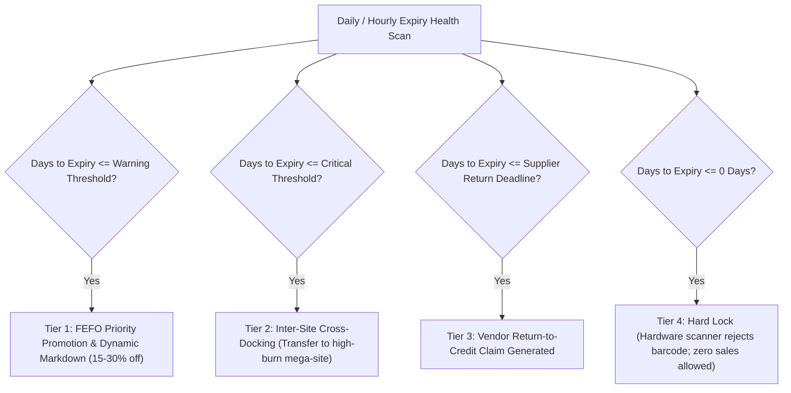

# Rule: Perishable Safety & Automated Liquidation Cascade

To prevent dispensing expired pharmaceuticals or pouring bad concrete, the system mandates automated hardware and software locks.

---

## 4-Tier Automated Liquidation Cascade

---

## Invariant Safety Checks

1. **Hard Scan Rejection:** If `current_date >= lot.expiry_date`, the barcode scanner at the POS terminal, nursing station, or construction gate must emit an audible alarm and throw an unbypassable exception.
2. **Cold-Chain IoT Breach Lock:** If Mean Kinetic Temperature ($T_K$) exceeds the allowable range ($2^\circ\text{C} – 8^\circ\text{C}$ for biologics), the batch must immediately transition to `QUARANTINED` pending QA approval.
